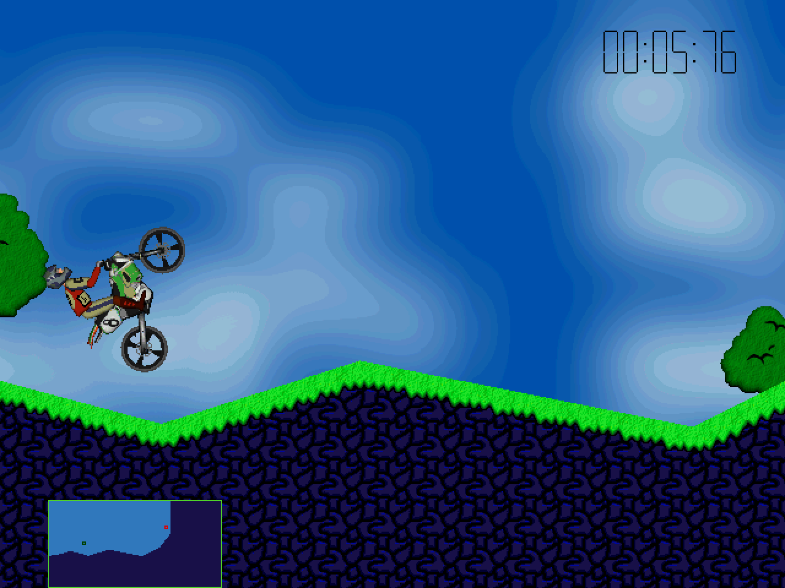

# Elasto Mania Classic SDL2

A preservation-focused, unofficial native port of the original **Elasto Mania** source release. The original physics, collision code, game rules, menus, editor, replay system, and indexed software renderer run behind a new SDL2 platform layer. This is not a physics remake and does not execute or wrap `Elma.exe`.

**x86 is the 1:1 compatibility target. ARM64 and other architectures are experimental.** The port is playable on the tested Linux x86-64 configuration, but exact equivalence to the original Windows binary has **not yet been certified**. See [compatibility](docs/COMPATIBILITY.md) before using it to compare records or physics behavior.



*The real port running Warm Up with the original game data, at 2× nearest-neighbor scale. Captured from the SDL renderer, not a mock-up. [Capture provenance and test results](docs/TEST_REPORT.md). Game artwork remains the property of its respective rights holders.*

## What is included

The original game runs natively with SDL2 windowing, keyboard/mouse input, presentation, timing, and audio output. The internal 640 × 480 indexed framebuffer, palette conversion, camera framing, physics equations, collision special cases, and original variable-step scheduling are retained. Fullscreen and resizable windows scale that original view rather than add extra visible terrain.

The port reads the original resource, graphics, level, replay, and profile formats. Original assets are supplied separately. A writable profile overlay keeps saved settings, times, replays, and edited levels out of the installed game directory.

CMake builds, regression tests, an optional real-game X11 smoke driver, and architecture/compiler status reporting are included. No AI model, training service, executable patcher, or network service is part of this port.

## Platform status

| Configuration | Status in this release |
|---|---|
| Linux x86-64, GCC, x87 compatibility backend | Built and run; gameplay, demos, replay playback, external levels, and editor checks performed. Original-binary parity is pending. |
| 32-bit x86, GCC/MinGW | Compatibility target; build recipe included, not executed in the delivery environment. |
| Linux x86-64, Clang / portable arithmetic | Built and run, explicitly **experimental** for numerical compatibility. |
| ARM64 and other little-endian architectures | **Experimental**; portable code path provided, native execution not yet validated. |
| Windows and macOS | Build instructions provided; not runtime-tested for this release. Compiler/backend status still applies. |
| Android, iOS, browser, consoles | Not packaged or lifecycle-adapted yet. SDL2 availability alone does not make these completed ports. |
| Big-endian systems | Rejected at compile time until remaining binary I/O is made field-wise. |

The program prints its compatibility class on startup and in the window title. A successful build or a passing replay is not a claim of exact physics parity.

## Build and run

Requirements: a C++17 compiler, CMake 3.18 or newer, and SDL2 **2.0.18 or newer**, including development headers. SDL2_image, SDL2_mixer, SDL_ttf, DirectX, Wine, and Proton are not required.

### Linux

Debian/Ubuntu example:

```sh
sudo apt-get install build-essential cmake ninja-build pkg-config libsdl2-dev
cmake -S . -B build -G Ninja -DCMAKE_BUILD_TYPE=Release
cmake --build build --parallel
ctest --test-dir build --output-on-failure

./build/elma-sdl2 --data-dir /path/to/Elma
```

On Arch Linux, the repository package is now `sdl2-compat`, an SDL2 API layer over SDL3. It can provide the build dependency, but **this release was tested with the real SDL2 2.32.4 runtime, not sdl2-compat**. Record which implementation is installed when reporting issues. For reference comparisons, use a genuine SDL2 installation and point CMake at its prefix. See [build details](docs/BUILDING.md).

### Windows and macOS

Windows: use the MSYS2 **UCRT64** shell with GCC, CMake, Ninja, and `mingw-w64-ucrt-x86_64-SDL2`, then run the same CMake commands. Run the executable from that shell so its SDL2 and compiler-runtime DLLs are available. The MinGW/GCC x86 build selects the x87 compatibility backend; Windows execution has not been tested here.

macOS: install SDL2, CMake, and Ninja, then use the same commands. Apple Clang/Apple Silicon builds use the explicitly experimental portable arithmetic backend. Detailed commands and 32-bit x86 guidance are in [BUILDING.md](docs/BUILDING.md).

### Supply your own game data

Point `--data-dir` at an unpacked original game installation, not at the ZIP:

```text
Elma/
  Elma.res
  Lgr/
    Default.lgr
  Lev/                 optional external levels
  Rec/                 optional existing replays
```

`Elma.exe` is not required at runtime. Do not upload the executable, resource file, graphics package, or original profile to this repository. Preserve the installation as a read-only source of assets.

The default build matches the supplied **registered 1.0 resource layout**. A separate `-DELMA_SHAREWARE=ON` build selects the original `SARVARI` layout; that edition has synthetic directory tests but has not been exercised with a complete shareware installation. Later/remastered game data is not assumed compatible.

Check an installation without running the game:

```sh
python3 tools/check_assets.py /path/to/Elma
```

### Profiles and existing progress

A fresh profile is created by default in the directory returned by `SDL_GetPrefPath`. The actual path is printed at startup. Use an explicit path to keep experiments and normal play separate:

```sh
./build/elma-sdl2 --data-dir /path/to/Elma --user-dir "$HOME/elma-sdl-profile"
```

The original installation's `state.dat` is **not loaded automatically**. To start with existing progress and key bindings, copy it explicitly into a new profile:

```sh
./build/elma-sdl2 --data-dir /path/to/Elma \
  --user-dir "$HOME/elma-sdl-imported" \
  --import-state /path/to/Elma/state.dat
```

Import refuses to overwrite an existing profile state. The original editor's progress requirement remains in place; this port does not unlock levels or bypass it. Use a separate profile per concurrently running process. Do not share one writable profile between instances, and keep normal backups.

## Controls and presentation

Original control bindings are retained and can be changed in the original Options menu. For a fresh profile:

| Action | Player A |
|---|---|
| Accelerate / brake | Up / Down |
| Rotate | Left / Right |
| Change direction | Space |
| Map / timer / alternate view | V / T / 1 |
| Leave gameplay or go back | Escape |
| Fullscreen toggle, added by the port | F11 |
| Screenshot of the actual SDL output, added by the port | F12 |

Player B uses the original numeric-keypad bindings. F11/F12 are reserved by the SDL backend, so imported bindings on those keys should be changed. The original menus use polled physical keys, not OS key-repeat or text input; keyboard layout behavior intentionally follows the original scan-code mapping.

```sh
./build/elma-sdl2 --data-dir /path/to/Elma --fullscreen --integer-scale
./build/elma-sdl2 --data-dir /path/to/Elma --no-vsync --fps 60
./build/elma-sdl2 --data-dir /path/to/Elma --no-audio
```

`--fps` limits presentation when vsync is off; it does **not** introduce a fixed physics tick. Timing and input sampling can still influence the original simulation, so keep presentation settings consistent during comparisons. `--no-audio` disables output, not the game-object event queue.

F12 writes BMP files into the profile's `screenshots` directory. `--capture /path/frame.bmp` chooses a fixed destination. `--help` lists the diagnostic input log, timed capture, and test-timeout options. These are developer diagnostics, not a deterministic game-stepping API.

## Tests and compatibility work

```sh
cmake -S . -B build-asan -G Ninja \
  -DCMAKE_BUILD_TYPE=Debug -DELMA_SANITIZERS=ON
cmake --build build-asan --parallel
ctest --test-dir build-asan --output-on-failure
```

The asset-free suite checks original disk layouts, x87 configuration, the MSVC random sequence, 40,000 texture-sampler cases, path handling, profile isolation, resource decoding, muted event delivery, and image output. The optional X11 smoke driver exercises the real game using your installed assets. See [TEST_REPORT.md](docs/TEST_REPORT.md) for the exact executed checks and limits; the GitHub workflow is supplied for future runs, not presented as an already-passing CI badge.

For a compatibility report, include `--version` output, compiler/build flags, SDL implementation/version, platform, asset hashes, level/replay identifiers, presentation settings, and a reproducible input sequence. The next acceptance milestone is a controlled original-executable comparison, including difficult collision and control cases. ARM64 remains experimental even after a basic smoke test passes.

## Source and licensing

The original source was published by the Elasto Mania Team; the supplied source snapshot is preserved through [provenance and change records](docs/PATCH_NOTES.md), with its original [release README](docs/UPSTREAM_README.md).

**The upstream license is not a permissive software license.** Read the unchanged [LICENSE.md](LICENSE.md): it includes the rights-holder-specific license, CC BY-NC-SA 4.0, and additional restrictions. Modified source and new port code are distributed under those retained terms. This is an unofficial port, not an official Elasto Mania release or an endorsement by the original authors. Game assets are not relicensed by this repository.
